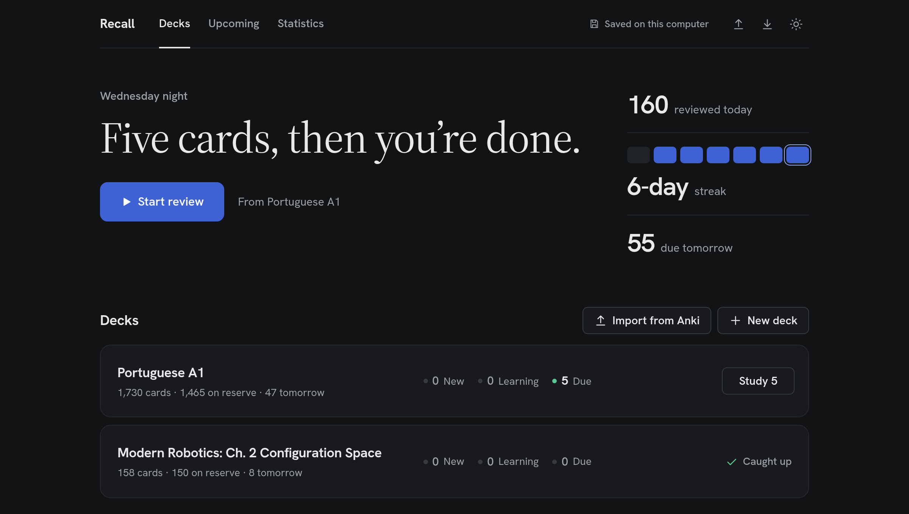
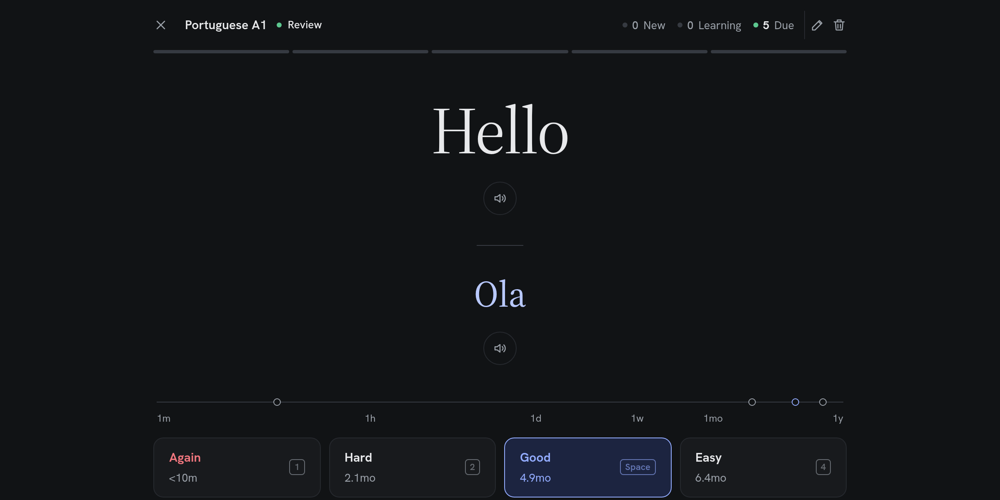

# Recall

A small, fast flashcard app with Anki's scheduling and a cleaner interface, hosted on one small server for a group of friends and family. Each person has their own account, decks and progress; the admin makes decks and gives them to people. Cards are read aloud: English on one side, European Portuguese on the other.





## Features

- **Accounts.** Each person signs up with an invite code and logs in with a username and password, on a phone or a laptop. Their decks, progress, statistics and settings are their own.
- **Given decks.** The admin gives a deck to the people who should study it. It arrives on their reserve, and they pull cards in at their own pace. When the admin edits, adds or deletes cards, everyone who has the deck sees the change, and nobody's progress is lost.
- **Decks and cards.** Create as many decks as you like; add, edit, move, search and delete cards.
- **Urdu on the front.** On a deck where the owner ticks **Translate the front into Urdu**, every card gets an Urdu translation of its Portuguese from Google Translate, in Urdu script and in Roman Urdu. Cards added or edited later are translated automatically, in the background on the server. Each person chooses in their own deck settings whether the front shows English, Urdu or both, and which Urdu writing to use; the back stays Portuguese. The admin can correct a translation in the card editor, and the fix reaches everyone. The Urdu is read aloud in an Urdu voice. See [Urdu on the front](#urdu-on-the-front).
- **Filters.** Narrow a deck's card list to new, learning, due, not-yet-due or reserve cards, by when the next review falls, when a card was added or how often it was forgotten, and sort it. Tick cards, or everything the filters show, to delete them together.
- **Maths and images.** Build equations in a visual editor, or write them in LaTeX, and they are typeset on the card. Paste a screenshot, drop a picture or pick a file to put it on either side.
- **Import from Excel.** Turn a spreadsheet of words into cards in one step, pictures and maths included.
- **Import from Anki.** Bring in an `.apkg` file and carry on where you left off: every card keeps its due date, interval and ease, and its images and maths.
- **Anki's scheduler.** Ported from Anki's source: FSRS-6, the default for every deck at 90% retention, and its older algorithm (SM-2) as a per-deck option, with the same learning steps, relearning, interval fuzz and 4am day rollover. FSRS-7, the newest version of FSRS, is a third option; Anki does not ship it yet.
- **Intervals on the buttons.** Again, Hard, Good and Easy each show when the card would come back.
- **A reserve.** Keep cards aside in a deck, out of study, and pull in as many as you like when you are ready for them, in an order you can rearrange. Fill it from a CSV or Excel file, or with reversed copies of cards you choose.
- **Upcoming cards.** How many cards come up on each day of the next week, month or three months, new, learning and due, for one deck or all of them.
- **Statistics.** A forecast of upcoming reviews, a year-long activity calendar, how many cards are new, learning, young and mature, and how often you press each answer button.
- **Read aloud.** A speaker button on each side of a card, a language for each side, optional auto-play, and an adjustable speaking speed. Maths and images are skipped. Audio is generated once per sentence and cached, unless a deck is set not to keep it.
- **Saved on the server.** Only what changed is sent, so a phone and a laptop used on the same day do not overwrite each other. Answers given with no signal are kept in the browser and sent when the connection is back. The server keeps a dated backup each day.
- **Keyboard-first studying**, light and dark themes, and a layout that works on a phone.
- **One dependency to install.** The app is plain HTML, CSS and JavaScript; the server is plain Node with its built-in SQLite. The only package is Anthropic's SDK, for sorting the admin's cards into topics; run `npm ci` once (the deploy script does it for you), and everything but that sorting works without it or a key. [KaTeX](https://katex.org), which typesets the maths, and [MathLive](https://mathlive.io), the equation editor, are included in `vendor/`, so maths works offline.

## Accounts, invites and the admin

- **Signing up needs an invite code.** There is no public sign-up. The admin makes codes on the Admin screen and sends them; each can be used by one or more people (up to 20).
- **The admin** is the owner's account, made when the owner's existing data is moved in (see the [runbook](deploy/RUNBOOK.md)). The account menu, under the name at the top right, has **Admin**, which lists the people, the invite codes and the admin's decks.
- **Giving decks.** On the Admin screen, **Give to…** on a deck chooses who has it. The whole deck lands on each person's reserve, in the admin's order: the cards the admin has studied first, then the admin's reserve. Cards added to the deck later join the end of everyone's reserve.
  On a deck with Urdu switched on, **Give to…** also has an **Urdu** checkbox for each person. Ticking it sets that person's front to Urdu from the start; they can still change it themselves in their deck settings afterwards.
- **What is shared and what is not.** The cards' text and the deck's name and languages come from the admin and follow the admin's changes. Everything else is each person's own: their schedule on every card, the reserve order, new cards per day, the scheduler, retention and the voice settings. A given deck cannot be edited by the person it was given to, but they can study it and use its reserve.
- **Taking a deck back** hides it from that person and keeps their progress, so giving it again picks up where they left off. **Deleting** a deck the admin has given removes it, and everyone's progress on it, after a warning that says how many people have it.
- **Forgotten passwords.** There is no reset email. The admin sets a new password with **Reset password** on the Admin screen.
- Everyone can still make their own decks and import from Excel or Anki; those stay private to them.

## Hosting it

Recall runs on one small server (a VPS of about €4–6 a month) behind [Caddy](https://caddyserver.com), which provides HTTPS. The [runbook](deploy/RUNBOOK.md) goes through it step by step: buying the server and a domain, setting the server up with `deploy/setup.sh`, moving the owner's data in, deploying with `deploy/deploy.sh`, inviting people, and copying and restoring backups.

## Running it locally for development

You need [Node.js](https://nodejs.org) 22.15 or newer.

```bash
git clone https://github.com/mahen2-cmd/recall.git
cd recall
RECALL_DATA=./data node server.js
```

Open **http://localhost:5173**. The first account has to be an admin, and there are two ways to make one:

- **From an old `data/recall.json`**, the file the earlier single-person version kept. This moves every deck, card and statistic into `data/recall.db` under a new admin account, and checks that nothing changed on the way:

  ```bash
  node scripts/migrate-json.js --data ./data --username admin --name "Your name"
  ```

  It asks for the password, or takes it from `RECALL_ADMIN_PASSWORD`.
- **From nothing**, by putting an empty `{"decks":[],"cards":[]}` in `data/recall.json` and running the same command.

Then log in, make an invite code on the Admin screen, and sign up a second person in a private window to see the app as they do.

The server reads these settings from the environment:

| Variable | Default | What it is |
|---|---|---|
| `PORT` | `5173` | The port it listens on, on 127.0.0.1 only |
| `RECALL_DATA` | `./data` | The data folder |
| `RECALL_ORIGIN` | none | The public address, such as `https://recall.example.com`, when it is behind a proxy. Requests for that host are accepted, and the login cookie is marked secure for HTTPS |

For the full set of voices, run this once (needs Python 3; `ffmpeg` is optional):

```bash
npm run setup-voice
```

## Studying

A new card starts with Anki's default learning steps:

| Button | New card | What it does |
|---|---|---|
| **Again** | <1m | Back to the first step |
| **Hard** | <6m | Stays on the current step |
| **Good** | <10m | Moves to the next step, then graduates to review |
| **Easy** | 4d | Graduates straight away |

After that, the schedule depends on the deck's scheduling setting:

- **SM-2** (Anki's older default). Each interval is the previous one multiplied by the card's ease, which starts at 250%. Pressing Good every time gives 1, 3, 8, 20, 50, 125 days and so on. Easy adds a 30% bonus and raises the ease; Hard grows the interval by 20% and lowers the ease.
- **FSRS-6.** Intervals come from a model of how well you remember each card, aiming for the deck's desired retention. This is what Anki does when FSRS is switched on.
- **FSRS-7.** The newest version of the same model. It also learns from answers given minutes apart, such as those in the learning steps, which FSRS-6 counts as no time at all. With its default parameters it gives much longer intervals than FSRS-6, so try it on one deck first.

In all three, forgetting a review card sends it through one 10-minute relearning step. A deck can switch between them at any time, because all three sets of scheduling data are kept for every card.

### On a phone

- **Tap the card** to show the answer, or press **Show answer** at the bottom.
- **Swipe the answer** to rate it: right for Good, left for Again, up for Easy, down for Hard. A stamp on the card shows the answer and when the card comes back; let go short of it and nothing happens. A long answer scrolls instead of swiping up and down, and a wide equation scrolls sideways. The four buttons work too.
- Edit, delete and listen again are in the **⋯** menu at the top.
- A deck's page has three tabs, **Cards**, **Reserve** and **Topics**, with **Study** and **Add card** at the bottom. Hold a card to tick it; ticked cards get a toolbar along the bottom, and on the Reserve tab **Move** puts them up, down, to the top or to the bottom.

### Keyboard shortcuts

| Key | Action |
|---|---|
| `Space` or `Enter` | Show the answer, then rate Good |
| `1` `2` `3` `4` | Again, Hard, Good, Easy |
| `R` | Replay the audio |
| `E` | Edit the current card |
| `Ctrl` + `Enter` | Save in the card editor |

### Deck settings

Each deck has its own:

- **New cards per day** (default 20).
- **Easy interval** (default 4 days): how far out Easy sends a card you are learning for the first time. With FSRS, 0 lets FSRS choose, which is what Anki does. With FSRS-7, Easy is always at least a day longer than Good, so a short easy interval may be raised.
- **Scheduling**: FSRS-6 (the default), FSRS-7 or SM-2.
- **FSRS retention** (default 90%), used by FSRS-6 and FSRS-7. Higher means fewer forgotten cards and more reviews.
- **Auto-play audio**: off, front, back or both sides.
- **Front language** and **Back language** (default English (US) and Portuguese): the language each side is read in.
- **Speaking speed**, from normal down to very slow.
- **Keep the audio made for this deck** (on by default). Turn it off for decks that are mostly maths: audio is then made each time a side is played and thrown away after, and `npm run cache-voice` leaves the deck out.

## Maths and images

### Maths

In the card editor, press **Maths** above a side to open the equation editor, and type the maths as it looks:

- `/` starts a fraction, `^` a power and `_` a subscript. The arrow keys move out of them, and between the cells of a matrix.
- Type `sqrt`, `theta`, `omega`, `pi`, `sum` and the like by name.
- The buttons above the box insert a fraction, a square root, a power, a subscript, a dot (ẋ), a vector arrow, and 2×2, 3×3 and 4×4 matrices. The menu at the end of the box has more, including matrices of any size.
- On a phone, a maths keyboard opens.
- Tick **On a line of its own** to centre the maths on its own line, and press **Insert** or Enter.

To change maths already on a card, click it in the preview under the text box, or put the cursor in it and press **Maths**.

The editor writes LaTeX into the card, and you can also type LaTeX yourself between these markers:

| Write | For |
|---|---|
| `\( ... \)` | maths within a line of text |
| `\[ ... \]` | maths on a line of its own, centred |

For example:

```
Back:  \[ R_z(\theta) = \begin{bmatrix} \cos\theta & -\sin\theta & 0 \\ \sin\theta & \cos\theta & 0 \\ 0 & 0 & 1 \end{bmatrix} \]
Back:  Through the Jacobian: \( \dot{x} = J(q)\,\dot{q} \)
```

These are the markers Anki uses, so cards written for Anki work unchanged. A dollar sign is never taken for maths. The card editor shows a preview of a side as soon as it holds maths or an image, and a formula with a mistake in it is shown in red rather than hiding the card.

The equation editor is [MathLive](https://mathlive.io), included in `vendor/` and loaded the first time it is opened.

### Images

In the card editor, put an image on a side in any of these ways:

- **Paste** it into the side's text box, for example a screenshot copied from a page of a book.
- **Drop** an image file onto the text box.
- Press **Add image** above the text box and choose one or more files.

PNG, JPEG, GIF, WebP and SVG images up to 20 MB are accepted. Each is kept on the server in the data folder's `media/` and appears in the text box as `[image:...]`, which you can move about like any other text or delete to take the image off the card. The same picture added twice is only kept once.

### Urdu on the front

For learners whose first language is Urdu, a deck can show Urdu on the front instead of English.

- **Switching it on.** The deck's owner ticks **Translate the front into Urdu** in Deck settings. Every card then gets an Urdu translation of its Portuguese, in Urdu script and in Roman Urdu (Urdu in Latin letters). It fills in over a while; cards added or edited later are translated automatically, in the background on the server, so nobody waits for it.
- **Choosing what you see.** Each person sets two things in their own Deck settings: **Front shows** (English, Urdu or Both) and **Urdu writing** (Urdu script or Roman Urdu). The back stays Portuguese. Urdu is read aloud in an Urdu voice, and with Both the English is read first, then the Urdu.
- **Correcting a translation.** In the card editor, the admin sees **Urdu** and **Roman Urdu** boxes. Changing them fixes the card for everyone who has the deck. **Translate again** discards the correction and brings Google's version back shortly after the card is saved.
- **Giving a deck.** In **Give to…**, an **Urdu** checkbox per person switches their front to Urdu. They can change it themselves afterwards.
- **Where the translations come from.** Google Translate's free, unofficial service, the same kind the app uses for voices. Google publishes no address for this, so it could stop answering without notice. If it does, new cards wait without a translation, and every translation already saved keeps working.
- **Filling a deck at once.** On the server, `node scripts/translate-urdu.js --data <dir> --deck "<name>"` translates every card that needs it and prints `Translated N, failed M, already done K.` Run it again to retry the failures. It refuses if the deck does not exist or **Translate the front into Urdu** is not switched on.

### Reading aloud

Only a side's words are read: maths and images are skipped, and a side with nothing else on it has no speaker button.

## The reserve

Each deck has a reserve: cards that are kept in the deck but out of study, so they are not counted as new cards and never come up, until you pull them in.

On a wide screen the deck's page shows the reserve in a column of its own, on the left, beside the cards you are studying; every card in it is numbered by its place in the line. On a phone, a tablet or a narrow window (below 900 pixels wide) it is the deck's **Reserve** tab instead.

- **Add to it** with **Import to reserve**, in the reserve column's **⋯** menu (on a phone, the reserve's menu), which takes a CSV or Excel file with one column for the front and one for the back. The ordinary import and the card editor also have a reserve checkbox.
- **Pull from it** by typing how many cards you want at the foot of the reserve column and pressing **Pull in the next N**. The cards that will come in are tinted, with a line under the last of them, and the tint follows the number as you type. A deck with topics has a topic menu above the number: choosing a topic lists only that topic's reserve cards, and pulls only from it. **Pull all** in the column's **⋯** menu takes everything, or everything in the chosen topic. Cards come out from the front of the reserve, and are then studied in that order, after the new cards already waiting. Searching narrows the column too, but each card keeps its number, and Pull in still takes the next cards of the whole line.
- **Pull specific cards** by ticking them in the reserve column, or searching for them first, and pressing **Pull in** at its foot. Only those come in, in their reserve order. On a phone, the Reserve tab does the same.
- **Reorder it** in the reserve column: drag a card to a new place, or tick several and drag one of them, or use **Up**, **Down**, **To top** and **To bottom** at the foot to move them together. **Reverse order**, in the column's **⋯** menu, turns the whole reserve around, so the last card is pulled in first; press it again to turn it back. Until you rearrange it the reserve is oldest first, which for an imported file is the order of its rows; cards added afterwards join the end.

- **Add reversed cards** by ticking cards in the deck's list and pressing **Add reversed**. Each ticked card gets a copy with its front and back swapped, placed at the end of the reserve with a schedule of its own, and left ticked so you can move the copies straight away. A card that already has a reversed version in the deck is skipped. A reversed card is read aloud in the right language on each side, and auto-play follows the language rather than the side.

Pulled cards become ordinary new cards, so they are introduced at the deck's new cards per day; raise that setting to study more of them at once. To put cards back, tick them in the deck's list, whether new, learning or due, and press **Back to reserve**; they join the end of the reserve. A card that has already been studied loses its progress and starts over as a new card when pulled in again, so you are asked first.

## Topics

A deck can be split into **topics**, and topics can sit in **groups** (Verbs, Grammar, and so on). Each card is in at most one topic; a card with none is **Unsorted**.

- **Study by topic.** When you start a review, choose Everything, or tick groups and topics. Only the due and new cards in those topics come up. Answers are scheduled as usual, and cards outside your choice stay due and wait. The daily new-card limit is still one total for the deck, shared across topics.
- **Pull by topic.** **Pull in** can be limited to a group or a topic, so you can bring in 20 new verb cards and nothing else.
- **See and change topics.** The deck's card list can be filtered by topic, shows each card's topic, and has **Move to topic…** for the cards you tick. Topics and groups can be renamed, moved, made and deleted. Deleting a topic makes its cards Unsorted.
- **Topic files.** Importing a file named `new_cards_<topic>.csv` puts its cards in that topic, and makes the topic if it is new.
- **Automatic sorting, for the admin only.** New cards in a deck the admin owns are placed in the deck's topics by an AI model (Claude, through Anthropic's API), and **Sort now** does the unsorted ones on request. A deck with no topics yet is sorted in two steps: the model proposes groups and topics, you change them, and only then are cards placed. Cards you place by hand are never moved again. Studying never waits for sorting. Given decks and other people's decks are never sent anywhere.
- **What leaves your server.** For the admin's decks, the text of each card's front and back, and the deck's group and topic names, are sent to Anthropic's API. Nothing else is: no answers, schedules or accounts. Sorting needs a key: set `ANTHROPIC_API_KEY`, or put `{"apiKey": "...", "model": "claude-opus-5-5"}` in `claude.json` in the data folder. With no key, sorting is off and the rest works as before.

## Statistics

The chart button in the top bar opens the statistics for all decks; the one on a deck's page opens that deck's. Choose a period of 1 month, 3 months or 1 year.

- **Forecast.** The reviews already scheduled for each coming day (or week, or 30 days, for the longer periods). Today's bar includes anything overdue. New cards are not counted.
- **Activity.** A calendar of the past year, darker on days with more reviews.
- **Cards.** How many are new, learning, young (in review with an interval under 21 days) and mature (21 days or more), as in Anki.
- **Answer buttons.** How often you pressed Again, Hard, Good and Easy on learning, young and mature cards. **Retention** is the share of young and mature reviews that were not answered Again.

Recall records which button was pressed, and in which deck, from the version that added this page. Reviews done before that still count towards the activity calendar and the streak for all decks, but have no per-deck or per-button breakdown.

## Upcoming cards

The calendar button in the top bar lists the cards coming up for all decks; the one on a deck's page, or **See the days ahead** under its counts, lists that deck's. Choose to look 1 week, 1 month or 3 months ahead.

- **Totals** for today, tomorrow, the next 7 days and the next 30 days.
- **A chart** of each day, split into new, learning and due cards.
- **Day by day**, a table of every day with its new, learning and due cards and their total. Weeks start on a Monday.

Today counts what is waiting now, overdue cards included. Later days count the reviews already scheduled for them, and new cards at each deck's daily limit until there are none left, supposing you study every day. The cards you study come back on later days too, so those days fill up as you go. Cards on reserve are not counted until they are pulled in.

## Importing from Excel

Open a deck and press **Import**, then choose a file. Each row becomes one card.

- **Files:** Excel `.xlsx`, or `.csv` and tab-separated text. Old `.xls` files need to be saved as `.xlsx` first.
- **Columns:** pick which column is the front and which is the back. Column A and B are used by default.
- **Header row:** tick the box if the first row holds column titles.
- **Duplicates:** rows whose front is already in the deck are skipped, so the same file can be imported again after you add to it.
- **Preview:** the dialog shows the first cards and how many rows will be skipped before anything is added.
- **Maths:** cells can hold maths written with `\( ... \)` and `\[ ... \]`, as on any card.
- **Pictures:** a picture placed in a cell (**Insert → Pictures → Place in Cell** in Excel) goes on that side of the card. So does a picture floating over the sheet, by the cell under its top-left corner; in LibreOffice, anchor it **To Cell**. Pictures Recall cannot show, such as drawings Excel saves as EMF, are left out, and the app says how many.

Only the first sheet of a workbook is read, and rows missing either a front or a back are left out. Imported cards are new cards, in the order they appear in the file.

## Importing from Anki

In Anki, choose **File → Export**, pick **Anki Deck Package (.apkg)** and leave **Include scheduling information** ticked. In Recall, press **Import from Anki** on the deck list and choose that file. A dialog lists the decks and cards found before anything is added.

Each Anki deck becomes a Recall deck, and each card arrives exactly where it was in Anki's schedule:

- **Review cards** keep their due day, interval and ease, so the cards due today in Anki are the cards due today in Recall, and the next interval is worked out from the same numbers.
- **Learning and relearning cards** keep their step and the time they are next due.
- **New cards** stay new, in Anki's order.
- **Deck options** come across too: new cards per day, the easy interval, whether FSRS is on, and with FSRS the desired retention, the deck's parameters and each card's memory state. FSRS-7 starts from that FSRS-6 memory state the first time a card is shown, and uses its own default parameters.

Some things do not come across:

- Cards become plain text with their images and maths. Formatting and audio are dropped, and suspended cards are left out. Maths written for Anki's MathJax (`\(...\)` and `\[...\]`) is kept as it is, and Anki's `[$]...[/$]` and `[$$]...[/$$]` become the same. Images are copied into the data folder's `media/` as soon as the file is read, before the import is confirmed.
- Recall has no setting for custom learning steps, starting ease, easy bonus and the like. If a deck changes these in Anki, the dialog says which, and Recall uses Anki's defaults for them.
- The review history itself is not kept, only the schedule it led to.

Tick **Put these cards on reserve** in the dialog to keep the new cards out of study until you pull them in, in Anki's order. Cards already being studied in Anki keep their schedule either way.

Importing the same file again adds only the cards that are not in Recall yet. It does not update cards already imported, so reviews done in Anki afterwards are not picked up.

## Voices

The speaker reads each side of a card in the language set for it in the deck's settings: European Portuguese, or US or UK English. Several voice engines are supported, and the best one available is used automatically:

| Engine | Needs | Notes |
|---|---|---|
| Azure neural voices | An Azure Speech key | Official and supported |
| Google Translate | Nothing | The default, and first on the hosted server. Unofficial |
| Microsoft Edge voices | `npm run setup-voice` | Unofficial |
| Piper | `npm run setup-voice` | Fully offline; the fallback when nothing else is reachable. Portuguese only |

The Google Translate and Edge engines use addresses those companies do not publish for this purpose, so either could stop working without notice. When one fails, the next engine takes over. If the Edge voice breaks, running `npm run setup-voice` again updates it.

To have every card ready to be read aloud, reserve included, run `npm run cache-voice`. Decks set not to keep their audio are left out. It saves the audio for both sides of each card ahead of time, so studying never waits on the voice engine or needs the internet. Clips already saved are skipped, so it can be stopped at any time and run again to carry on, or to fetch the cards added since. It pauses after each new clip to go easy on the engine (`npm run cache-voice -- --delay=1500` to pause longer), and stops if the first-choice engine stops answering rather than filling in with a fallback voice. For now it reads the cards from `recall.json` in the data folder, the file from before accounts, so it covers the decks as they were at the move and not those added since.

Audio is made on the server and shared by everyone, so a sentence is fetched from the engine only once, and phones keep the clips they have played.

To change the engine or voice, create `tts.json` in the data folder (`/var/lib/recall/tts.json` on the server, where `setup.sh` writes `{"engine":"google"}`). Every field is optional:

```json
{
  "engine": "google",
  "voice": "pt-PT-RaquelNeural",
  "azureKey": "your-key",
  "azureRegion": "westeurope"
}
```

- `engine` is `google`, `edge`, `piper` or `azure`.
- `voice` applies to Edge and Azure, for example `pt-PT-DuarteNeural` for a male voice. It is used for its own language; the other languages use a standard voice.
- `azureKey` and `azureRegion` come from a Speech resource in the Azure portal.

Changes take effect on the next sentence played; no restart is needed.

## Your data

Everything lives in one data folder: `RECALL_DATA`, which is `./data` when running locally and `/var/lib/recall` on the server, outside the code folder.

| Path | Contents |
|---|---|
| `recall.db` | The SQLite database: accounts, sessions, invite codes, every deck and card, and each person's progress, statistics and settings |
| `backups/` | A copy of the database from each day, `recall-YYYY-MM-DD.db`; the last 30 are kept |
| `audio/` | Cached audio, one file per sentence per voice, shared by everyone |
| `media/` | The images on cards, named by their contents |
| `tts.json` | Voice settings and keys, if there is one |
| `claude.json` | The API key for sorting into topics, if there is one |

The local `data/` folder is git-ignored, so none of it is ever committed.

- The download button in the top bar (or **Export backup** in the account menu on a phone) saves your own decks, cards and progress as one JSON file. Images are not in it.
- Deleting a card or deck leaves its images in `media/`, as other cards may show the same ones.
- The top bar shows whether your changes are saved. If the connection drops, it says so; your changes are held in the browser and sent when it is back.
- Copying backups off the server, and restoring one, is in the [runbook](deploy/RUNBOOK.md#7-backups).

The server listens only on 127.0.0.1, so it is reached through Caddy. It accepts requests only for its own address, refuses API calls made from other websites, and limits how often anyone can try to log in or sign up.

## How it works

```
index.html          the page
css/styles.css      all styling, light and dark
js/fsrs.js          the scheduler: SM-2, FSRS-6 and FSRS-7 modes, with no browser code
js/store.js         decks, cards, the study queue, and syncing changes with the server
js/api.js           the calls to the server: log in, sign up, sync and the admin screen
js/content.js       finds the maths and images in a card's text, and the words to read aloud
js/mathspeech.js    turns maths into words to read aloud
js/counts.js        merges the day's answer counts from two devices
js/importer.js      reads .xlsx and CSV files into rows, with their pictures
js/app.js           the interface
server.js           serves the app and the API: sessions, sync, admin, images and speech
server/db.js        the SQLite schema
server/auth.js      accounts, password hashing, sessions and invite codes
server/sync.js      each person's view of the data, and applying their changes to it
server/fields.js    which deck and card fields are shared and which are each person's own
server/admin.js     listing people, and giving decks and taking them back
server/backup.js    the daily copy of the database
anki.js             reads an Anki package into decks and cards, with their images
vendor/katex/       KaTeX 0.18.11, which typesets maths (MIT licence)
vendor/mathlive/    MathLive 0.111.1, the equation editor, which uses KaTeX's fonts (MIT licence)
tts.js              the voice engines and the audio cache
scripts/            the voice setup, the audio pre-cacher, and the one-off move from recall.json
deploy/             the server setup, deploy script, systemd unit, Caddyfile and runbook
tests/              tests for the scheduler, the store, the importers and the server
```

The scheduler follows two sources: the memory models from [fsrs-rs](https://github.com/open-spaced-repetition/fsrs-rs), which Anki uses (FSRS-7 from fsrs-rs v7.0.0), and the learning, review and fuzz rules from [Anki's scheduler](https://github.com/ankitects/anki/tree/main/rslib/src/scheduler/states).

Run the tests with:

```bash
npm test
```

## Differences from Anki

- Fuzz uses Anki's interval ranges but a different random generator, so the exact day chosen within a range will not match Anki card for card.
- Learning steps are fixed at 1 and 10 minutes, and the relearning step at 10 minutes. The other Anki default options (starting ease, easy bonus, hard interval and so on) are fixed at Anki's defaults too.
- Easy on a new card gives exactly the easy interval (with FSRS-7, at least a day more than Good); Anki varies it by a day either way.
- FSRS-6 and FSRS-7 use their default parameters; they are not optimised from your review history.
- FSRS-7 is not in Anki yet. Recall keeps Anki's learning steps and whole-day intervals with it, rather than letting FSRS-7 schedule reviews within a day.
- There is no load balancer and no review limit per day, and cards have no templates.
- Cards are plain text, with maths and images. Maths is typeset with KaTeX rather than MathJax, which covers nearly all the same LaTeX.
